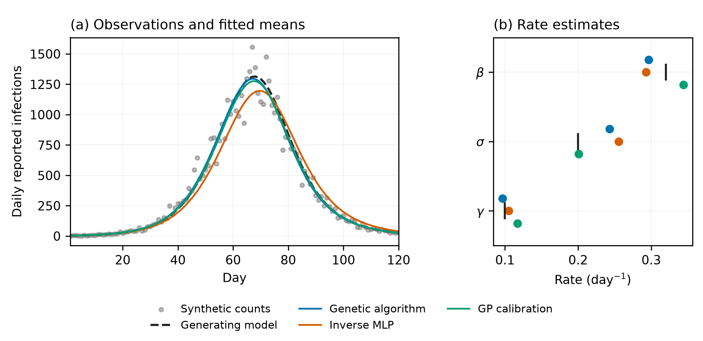

# Numerical SEIR illustration

This repository contains the numerical example accompanying *Artificial intelligence for calibrating epidemic spreading models: metaheuristic optimisation, inverse learning, and surrogate modelling*, by Pedro H. T. Schimit, Abimael R. Sergio, and Marco A. R. Fontoura. It is maintained by [Labdinpop](https://github.com/labdinpop).

One synthetic series is analysed with a genetic algorithm, an inverse multilayer perceptron (MLP), and Gaussian process calibration with Bayesian optimisation. The example illustrates their procedures. It does not establish a general ranking of methods, statistical reliability, or a computational advantage.

All observations are generated by the code. No external datasets, records about individuals, or observations from the referenced papers are required. Internet access is needed only to install the Python dependencies.



## Run

Use Python 3.12. Download this repository through **Code > Download ZIP** and extract it, or clone it with Git:

```console
git clone https://github.com/labdinpop/seir-calibration-example.git
cd seir-calibration-example
```

Open a terminal in the extracted or cloned folder. Create an environment and install the recorded dependencies:

```console
python -m venv .venv
```

On Windows:

```console
.venv\Scripts\python -m pip install -r requirements.txt
.venv\Scripts\python -m unittest discover -s tests -v
.venv\Scripts\python study.py --output runs/example
```

On Linux or macOS:

```console
.venv/bin/python -m pip install -r requirements.txt
.venv/bin/python -m unittest discover -s tests -v
.venv/bin/python study.py --output runs/example
```

These commands keep the supplied manuscript results in `results` and write the new execution to `runs/example`. Running `study.py` without `--output` writes to `results` and replaces files with the same names. Configuration values are read from `config.json`; `--config` selects an alternative file.

## What an execution does

1. Solves the SEIR model with the generating parameters in `config.json` and draws a synthetic daily count series.
2. Fits that series using a genetic algorithm.
3. Generates separate training and validation simulations, trains the inverse MLP, and applies it to the evaluation series.
4. Fits the same series using a Gaussian process surrogate and Bayesian optimisation.
5. Solves the original SEIR equations at each estimated parameter vector and saves the curves, estimates, diagnostic records, and comparison figure.

The terminal reports each method and its fitted rates. After completion, open `runs/example/seir_comparison.png` to inspect the figure and `runs/example/estimates.csv` to inspect the numerical estimates. The PDF version of the figure is suitable for inclusion in a manuscript. A new execution generally differs from the supplied example; the reproduction command below repeats the recorded computation.

## Common problem

The deterministic SEIR equations are solved with SciPy's DOP853 integrator. Population size is 100,000, with 40 exposed and 10 infectious individuals initially, no removed individuals, and the remaining population susceptible. The generating rates are `(beta, sigma, gamma) = (0.32, 0.20, 0.10)` per day. These are illustrative values, not estimates for a particular disease.

The compartments are susceptible (`S`), exposed but not yet infectious (`E`), infectious (`I`), and removed (`R`). With `N = S + E + I + R`, the equations are

```text
dS/dt = -beta*S*I/N
dE/dt =  beta*S*I/N - sigma*E
dI/dt =  sigma*E - gamma*I
dR/dt =  gamma*I
```

Here, `beta` is the transmission rate, `sigma` is the progression rate from exposed to infectious, and `gamma` is the removal rate. Time is measured in days and all three rates have units of inverse days. The continuous equations are integrated numerically; observations are accumulated over daily intervals.

The 120 daily observations represent new infections entering E, multiplied by a reporting fraction of 0.5. They are not the number of infectious people. Counts are sampled independently conditional on the expected trajectory from a negative binomial distribution with dispersion 50:

```text
mean = mu
variance = mu + mu**2 / 50
```

The same observations, initial conditions, reporting fraction, dispersion, and parameter bounds are supplied to all methods. The bounds are `[0.18, 0.50]` for beta, `[0.10, 0.40]` for sigma, and `[0.06, 0.16]` for gamma. Only these three rates are estimated. Their values do not become known to the estimators: the generating vector is used only to simulate and subsequently assess the example.

## Procedures

- **Genetic algorithm:** a population of 48 candidates, tournament selection, blend crossover, Gaussian mutation, and four retained elites. The search runs for 60 generations. The objective is the negative log likelihood of the synthetic observations under the original SEIR model. Mutation acts on parameters scaled to the unit cube.
- **Inverse MLP:** 2,048 parameter vectors for training and 512 separate vectors for validation, with two independent observation series per vector. The network has two hidden layers of 64 units and tanh activations. Counts are transformed with log(1 + y) and standardised using training data only. Targets are scaled by the prespecified parameter ranges, giving a squared parameter loss with explicit scale adjustment. Adam training stops according to validation loss, with the best validation weights retained. The recorded training objective includes the network's regularisation penalty; validation MSE is the mean squared parameter error on the scaled targets. The evaluation series is used only after training and model selection. Predictions outside the parameter bounds are projected onto the bounds and recorded explicitly.
- **GP calibration:** 32 initial parameter vectors and 64 sequential acquisitions, followed by one evaluation of a candidate selected using the predicted mean. A Gaussian process with a Matérn kernel approximates the negative log likelihood divided by the number of observation days. This constant scaling leaves its minimiser unchanged. A lower confidence bound with weight 2 selects candidates. Kernel hyperparameters are fitted every eight acquisitions. The final estimate is the best candidate actually checked with the SEIR solver. The surrogate depends on the particular observation series.

The procedures use different numbers of simulator evaluations and different training objectives. These counts are reported in `estimates.csv`; they include the simulations used to construct both the MLP training and validation sets. One additional solve per method reconstructs its final curve. There is no comparison of execution times or claim of performance under equal computational budgets. A fit with a small curve error does not establish parameter identifiability.

## Reproduce a recorded execution

By default, the random state is obtained from the clock. Separate streams govern the evaluation observations, optimiser, training design, training noise, validation design, validation noise, network, and GP design. `run.json` records these values, the entire configuration, the source hash, and package versions.

To reproduce the saved numerical example with the same source and environment:

```console
python study.py --replay results/run.json --output reproduction_check
```

The replay uses the recorded configuration even if `config.json` was subsequently edited, and rejects a different `study.py` source. Numerical roundoff can differ across operating systems and library builds. Do not select an execution because it favours a method; the retained results are one illustrative run, not a selected best performance.

Use the Python executable from the environment created above when running this command. On Windows it is `.venv\Scripts\python`; on Linux or macOS it is `.venv/bin/python`.

## Change the example

Copy `config.json` to `my_config.json`, edit the copy, and select a separate output directory:

```console
python study.py --config my_config.json --output runs/modified
```

Use the environment's Python executable here as well. The `model` block sets the population, initial states, generating rates, observation period, reporting fraction, dispersion, and estimation bounds. The `genetic_algorithm`, `inverse_mlp`, and `surrogate` blocks set the computational budgets and algorithm options. The order of all rate vectors and bounds is always `beta`, `sigma`, `gamma`. Keep the initial counts nonnegative and their sum below the population size.

Each execution generates its own synthetic observations and fits all three methods. The script does not accept an external health dataset. To reproduce the supplied example, use `--replay`, which takes its settings from the execution record instead of a modified configuration file.

## Files

- `study.py`: model, observation process, three procedures, output generation, and figure.
- `config.json`: all numerical and algorithm settings.
- `requirements.txt`: versions used for the retained execution.
- `tests/test_study.py`: checks of conservation, the incidence definition, the likelihood, integration accuracy, and genetic search.
- `results/synthetic_data.csv`: expected counts and the synthetic observations.
- `results/estimates.csv`: estimated rates, likelihood values, curve error, and simulator counts. The likelihood at the generating parameters is not assumed to be the minimum for a noisy observation series.
- `results/fitted_curves.csv`: mean curves reconstructed using the original SEIR solver.
- `results/ga_history.csv`, `mlp_history.csv`, `gp_history.csv`: search and training records.
- `results/run.json`: configuration, execution record, bounds checks, and numerical diagnostics.
- `results/verification.json`: numerical reproduction check and figure checksum.
- `results/seir_comparison.pdf`, `seir_comparison.png`: the figure used in the manuscript.

The virtual environment, new executions under `runs`, and temporary reproduction checks are excluded by `.gitignore`.

## Licence and citation

The code and accompanying documentation are distributed under the [MIT licence](LICENSE). Citation metadata are provided in [CITATION.cff](CITATION.cff).

## Method references

These implementations are didactic adaptations written for this review, not the original authors' software or reproductions of their datasets and results.

1. Yarsky, P. (2021). *Using a genetic algorithm to fit parameters of a COVID-19 SEIR model for US states*. Mathematics and Computers in Simulation, 185, 687–695. [DOI](https://doi.org/10.1016/j.matcom.2021.01.022).
2. Tessmer, H. L., Ito, K., and Omori, R. (2018). *Can machines learn respiratory virus epidemiology? A comparative study of likelihood-free methods for the estimation of epidemiological dynamics*. Frontiers in Microbiology, 9, 343. [DOI](https://doi.org/10.3389/fmicb.2018.00343).
3. Reiker, T., et al. (2021). *Emulator-based Bayesian optimization for efficient multi-objective calibration of an individual-based model of malaria*. Nature Communications, 12, 7212. [DOI](https://doi.org/10.1038/s41467-021-27486-z).

Software documentation: [SciPy integration](https://docs.scipy.org/doc/scipy/reference/generated/scipy.integrate.solve_ivp.html), [MLPRegressor](https://scikit-learn.org/stable/modules/generated/sklearn.neural_network.MLPRegressor.html), and [GaussianProcessRegressor](https://scikit-learn.org/stable/modules/generated/sklearn.gaussian_process.GaussianProcessRegressor.html).
